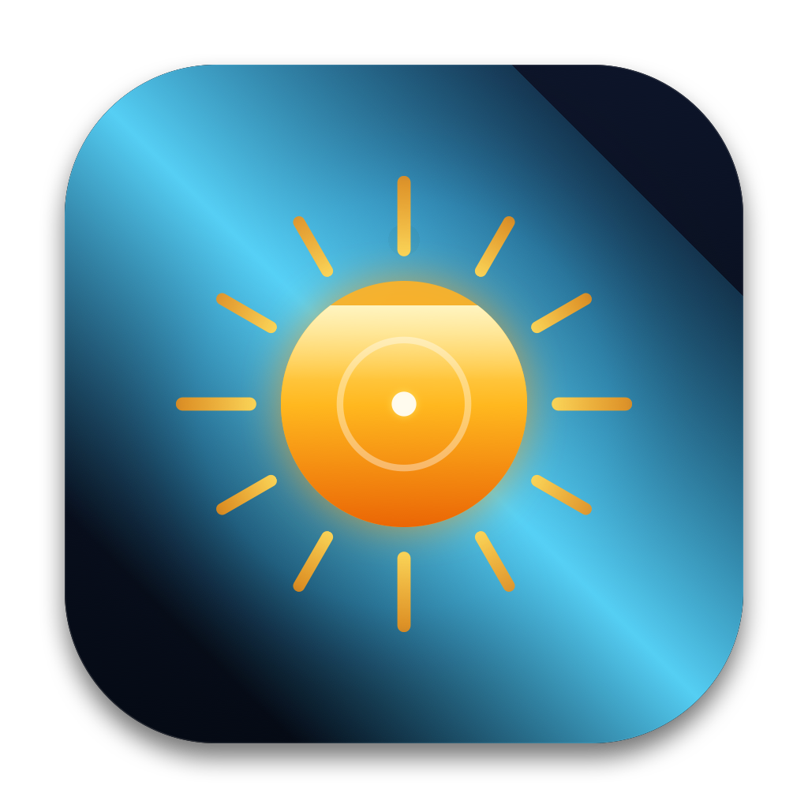
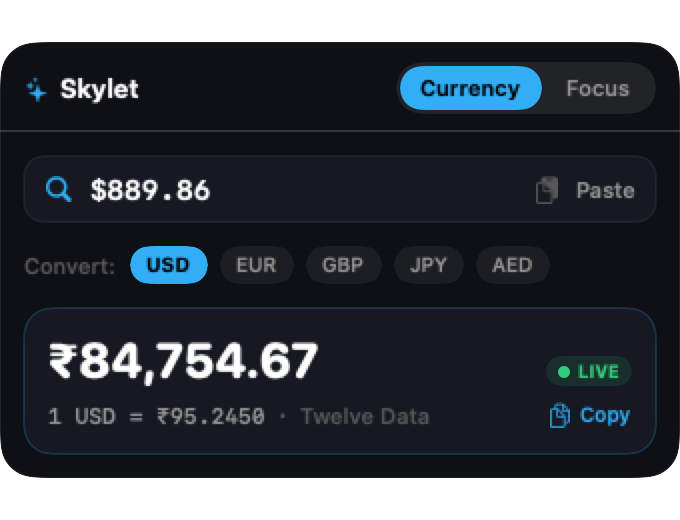
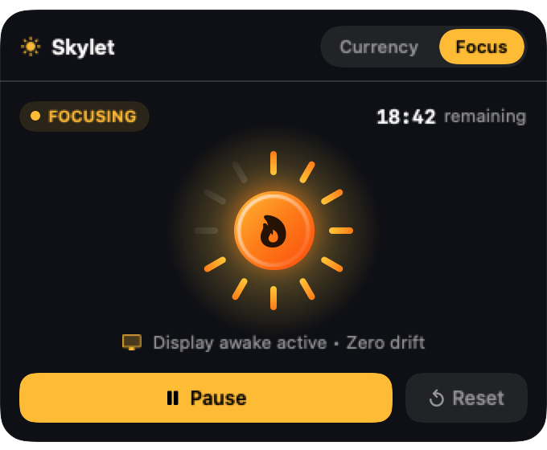
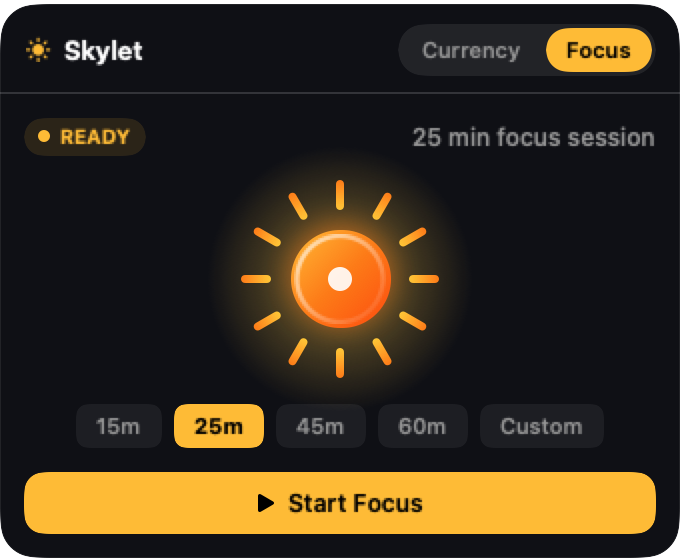
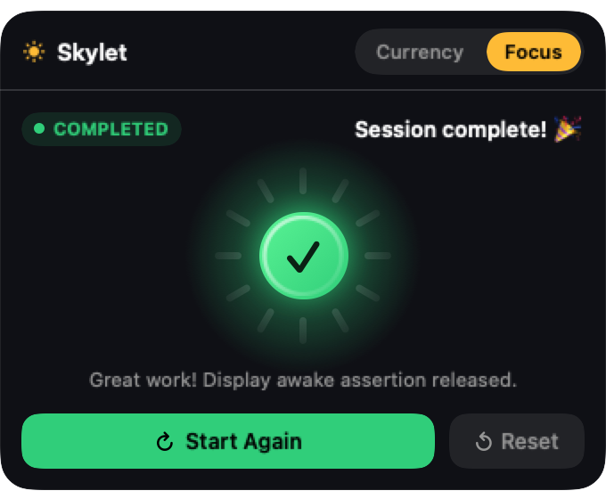

# Skylet ✦

<p align="center">
  
</p>

<p align="center">
  <strong>A premium native macOS DroppyKit utility featuring live currency conversion and an ambient solar Focus Timer.</strong>
</p>

<p align="center">
  <a href="https://github.com/NilambarSonu/SKYLET/releases/latest"></a>
  <a href="https://github.com/NilambarSonu/SKYLET/actions/workflows/build.yml"></a>
  
  
  
  <a href="LICENSE"></a>
</p>

---

### [➔ Download Latest SKYLET Release](https://github.com/NilambarSonu/SKYLET/releases/latest)

Skylet lives directly inside [Droppy](https://getdroppy.app)’s Dynamic Island and shelf. It delivers two essential native macOS workflows designed around **Quiet Precision. Instant Intelligence**:

1. **Currency Intelligence**: Real-time foreign exchange conversion to Indian Rupees (INR) using live quotes from Twelve Data Forex API with Apple Keychain security, honest quote timestamps, and instant clipboard import.
2. **Focus Timer**: Keep your Mac display awake during deep study, reading, or coding sessions using native macOS power assertions without touching global System Settings.

---

## Key Features

### 🪙 Currency Intelligence & Real-Time FX
- **Twelve Data Real-Time Forex API**: High-frequency live exchange rates for `USD/INR`, `EUR/INR`, `GBP/INR`, and over 1,500 currency pairs.
- **Apple macOS Keychain Security**: Stores your Twelve Data API key directly in macOS Keychain (`kSecClassGenericPassword`). Never logged, never shared, and never committed to source control.
- **Honest Provenance & Freshness Tracking**: Rates explicitly declare their true origin:
  - `LIVE`: Verified quote from Twelve Data received within the last 15 minutes.
  - `DELAYED`: Active quote during closed market hours or weekend halts.
  - `CACHED`: Served from local 5-minute pair cache (never falsely marked as live).
  - `DAILY REFERENCE`: Fallback reference rate from ExchangeRate-API or Frankfurter (ECB).
  - `STALE`: Quote age exceeding 72 hours.
  - `UNAVAILABLE`: Complete network failure.
- **Pure Decimal-Safe Arithmetic**: Financial conversions execute exclusively through Foundation `Decimal` (`NSDecimalMultiply`) preventing floating-point roundoff errors.
- **Searchable Currency Directory**: Built-in modal (`CurrencySelectorView`) with instant filtering by country, ISO currency code, symbol, or full name, with popular quick-pills (`USD`, `EUR`, `GBP`, `AED`, `CAD`, `AUD`, `SGD`, `JPY`, `SAR`, `CNY`).
- **Interactive Directional Currency Swap**: Instant reversal between foreign currency and INR with smooth $180^\circ$ rotation spring micro-interaction.
- **Live Rate Refresh**: Manual refresh button with $360^\circ$ rotation animation and concurrent request deduplication.
- **Clipboard Workflow**: Instant conversion of amounts on your clipboard with one click — zero continuous background clipboard snooping.
- **One-Click Copy**: Copies clean formatted summary (e.g. `100.00 USD = ₹8,350.00 (Illustrative example; real quotes use live market rate)`) with immediate in-place checkmark feedback.

### ⏱️ Focus Timer & Solar Instrument
- **Custom Solar Sun Instrument (`SolarSunView`)**: An animated visual instrument replacing anxious numeric countdowns. 12 radial solar beams progressively recede clockwise as time elapses, backed by an energetic amber core and celestial horizon arc.
- **Instant Reactive Controls**: Action button immediately reacts to user interactions (`Start Focus` ➔ `Pause` ➔ `Resume` ➔ `Start Again`), paired with an immediate secondary `Reset` button.
- **Zero-Drift Monotonic Deadline**: System-clock deadline tracking ensures time calculation never drifts even if the Mac sleeps or the UI is hidden.
- **Native Power Assertion**: Uses Apple's public `ProcessInfo.beginActivity(options: .idleDisplaySleepDisabled)` API to prevent idle screen sleep without administrator rights, terminal scripts, or mouse jiggling.
- **Strict Assertion Lifecycle**: Automatically releases display-awake assertions on pause, cancellation, session completion, or droplet deactivation.
- **Calibrated Duration Presets**: Quick-select chips for 15m, 25m, 45m, 60m, 120m, plus custom minutes entry.

### 🏝️ Dynamic Island & Shelf Integration
- **Continuous Notch Curvature**: Perfectly shaped with `18pt` shelf and `26.5pt` island radii, eliminating protruding sharp corners.
- **In-Place Currency Picker Overlay**: Layered selection overlay replaces rectangular AppKit modal sheets, maintaining seamless curvature and dark-chrome integration.
- **Dual Surface Layouts**: Full interactive canvas in Solo shelf layout (420pt) and compact glanceable canvas in Paired shelf mode (210pt).
- **Dynamic Island / Notch Live Activity**: Publishes a mini 18pt Solar Sun and compact remaining time in the notch Live Activity wings during active focus sessions.
- **Native Droppy Settings Pane**: Accessible via **Droppy Settings ➔ Skylet** with masked key input, latency tester, and quota notices.

---

## Installation & Setup

### Requirements
- **macOS**: 14.0 (Sonoma) or macOS 15.0+ (Sequoia)
- **Droppy**: 15.3.0 or later (installed in `/Applications/Droppy.app`)
- **Architecture**: Universal binary (`arm64` Apple Silicon + `x86_64` Intel)

### Step 1: Download the Droplet
Download [`Skylet.droplet.zip`](https://github.com/NilambarSonu/SKYLET/releases/latest) from the latest release and unzip it to obtain `Skylet.droplet`.

### Step 2: Install into Droppy
**Method A (Drag & Drop — Recommended)**:
1. Open Droppy from your menu bar or Applications folder.
2. Open **Settings** (`⌘,`) and navigate to **Droplet Store** (or **Developer**).
3. Drag and drop `Skylet.droplet` into Droppy.
4. Droppy will verify and load Skylet directly into your shelf.

**Method B (Manual Copy)**:
Copy `Skylet.droplet` to your Droppy droplets directory:
```bash
mkdir -p ~/Library/Application\ Support/Droppy/Droplets/skylet
cp -R Skylet.droplet ~/Library/Application\ Support/Droppy/Droplets/skylet/
```
Then restart Droppy:
```bash
killall Droppy && open /Applications/Droppy.app
```

### Step 3: Configure Real-Time Forex (Optional)
Skylet works out of the box using free daily reference rates. To unlock live, minute-by-minute real-time quotes:
1. Get a free API key at [Twelve Data](https://twelvedata.com/pricing) (Free tier: 800 req/day, 8 credits/min).
2. Open **Droppy Settings ➔ Skylet** (or open Skylet and switch to the **Settings** tab).
3. Paste your key and click **Test Connection** to confirm connectivity.
4. Click **Save Key**. Skylet will store it securely in macOS Keychain and immediately activate real-time quotes.

---

## Safe Staged Update Instructions

Updating Skylet is safe and completely preserves your Keychain-stored Twelve Data API key and local preferences. Follow this staged replacement procedure to ensure zero downtime and instant rollback capability:

1. **Stage Backup**: Move your current `Skylet.droplet` to `~/.Trash` or create a backup copy:
   ```bash
   cp -R ~/Library/Application\ Support/Droppy/Droplets/skylet/Skylet.droplet ~/Downloads/Skylet-backup.droplet
   ```
2. **Install New Release**: Download and unzip the latest `Skylet.droplet.zip` from [Releases](https://github.com/NilambarSonu/SKYLET/releases/latest), then copy `Skylet.droplet` to your Droppy droplets folder:
   ```bash
   cp -R Skylet.droplet ~/Library/Application\ Support/Droppy/Droplets/skylet/
   ```
3. **Reload Droplet**: Restart Droppy or trigger a droplet reload:
   ```bash
   killall Droppy && open /Applications/Droppy.app
   ```
4. **Automated Rollback**: If the new release fails to initialize for any reason, restore your previous version immediately:
   ```bash
   rm -rf ~/Library/Application\ Support/Droppy/Droplets/skylet/Skylet.droplet
   cp -R ~/Downloads/Skylet-backup.droplet ~/Library/Application\ Support/Droppy/Droplets/skylet/Skylet.droplet
   killall Droppy && open /Applications/Droppy.app
   ```

---

## Architecture & Verification

Skylet is engineered with strict separation between UI, financial domain logic, and hardware assertions:

```
SKYLET
├── Sources/
│   ├── SkyletCore/                  # Pure domain logic (zero host UI dependencies)
│   │   ├── Currency/                # Currency parser, Decimal arithmetic, Twelve Data provider
│   │   ├── Focus/                   # Monotonic timer, ProcessInfo power assertion controller
│   │   └── Security/                # Apple Security framework Keychain manager
│   ├── Skylet/                      # DroppyKit UI & Presentation layer
│   │   ├── Theme/                   # SkyletTheme design tokens (AdaptiveColors, DroppySpacing)
│   │   └── UI/                      # CurrencyView, CurrencySelectorView, FocusTimerView, SettingsView
│   └── SkyletTestsRunner/           # 133 automated unit tests
├── droplet.json                     # DroppyKit manifest (ABI 1, minAPI 1.6.0)
└── .github/workflows/               # CI build & automated release pipelines
```

### Visual Preview & Screenshots

<p align="center">
  
  &nbsp;&nbsp;
  
</p>
<p align="center">
  
  &nbsp;&nbsp;
  
</p>

### Run Automated Tests Locally
Skylet includes 133 automated unit tests covering financial arithmetic precision, parser edge cases, Twelve Data HTTP status codes, Keychain security, all 16 focus timer lifecycle requirements, and UI button state transitions:

```bash
swift run SkyletTestsRunner
```

### DroppyKit Validation
Validate the bundle using DroppyKit's official verification tool:

```bash
./.build/checkouts/droppykit/Scripts/droppykit validate --no-submission
```

---

## Documentation

- [Changelog](CHANGELOG.md) — Complete release history and version notes
- [Release Guide](docs/RELEASE.md) — Packaging and distribution details
- [Architecture](docs/ARCHITECTURE.md) — Deep-dive into Skylet's subsystems
- [Known Limitations](docs/KNOWN_LIMITATIONS.md) — Transparent platform boundaries and trade-offs
- [Testing Guide](docs/TESTING.md) — Test suite layout and mock isolation
- [Privacy Policy](docs/PRIVACY.md) — Zero tracking, local-only credentials

---

## License

Skylet is open-source software released under the [MIT License](LICENSE).
Droppy and DroppyKit are trademarks of their respective owners.
